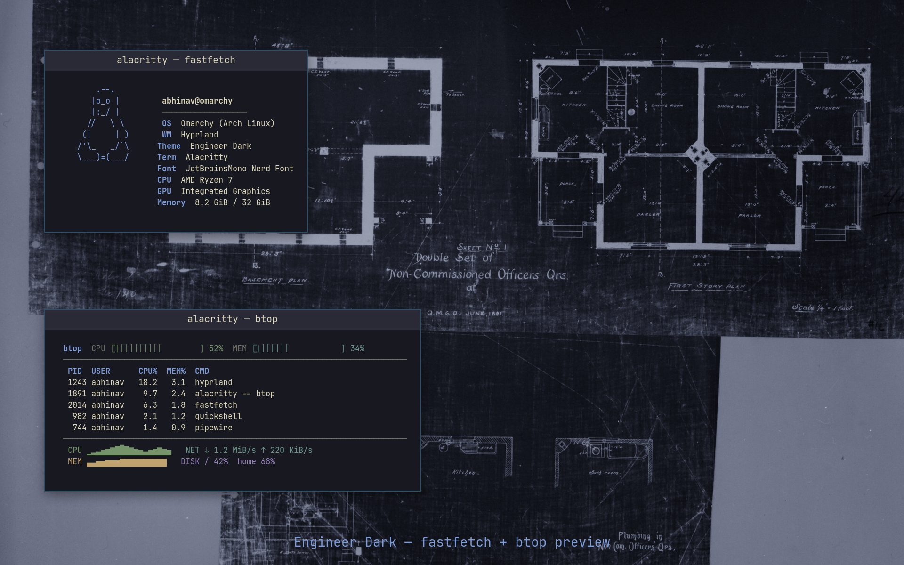

# Engineer Dark for Omarchy

**Engineer Dark** is a Kanagawa-inspired dark engineering theme for [Omarchy](https://omarchy.org/): deep sumi-ink surfaces, blueprint/cyan-blue accents, and technical drafting aesthetics built around real engineering blueprints and converted real-life construction imagery.



## Install

```bash
omarchy theme install https://github.com/abhinavbxr/omarchy-engineer-dark-theme
```

## Try locally

```bash
cp -r /path/to/engineer-dark ~/.config/omarchy/themes/
omarchy theme set engineer-dark
```

## Palette

Kanagawa-inspired dark palette defined in `colors.toml`:

| Role | Color |
| --- | --- |
| Background | `#1f1f28` |
| Foreground | `#dcd7ba` |
| Accent | `#7e9cd8` |
| Selection | `#2d4f67` |
| Muted | `#727169` |

Omarchy generates application themes from `colors.toml`.

## Backgrounds

Engineering blueprint and converted real-life imagery (all 2560×1440), sourced from the internet and processed for this theme:

- `backgrounds/01-fort-myer-blueprint.png` — converted architectural blueprint (Fort Myer NCO quarters plan)
- `backgrounds/02-glacier-station-blueprint-a.png` — converted engineering blueprint (Glacier Ranger Station plan)
- `backgrounds/03-glacier-station-blueprint-b.png` — converted engineering blueprint (Glacier Ranger Station elevations)
- `backgrounds/04-pampanga-bridge-construction.png` — converted real-life bridge construction photograph
- `backgrounds/05-pampanga-bridge-construction-ii.png` — converted real-life bridge construction photograph

Cycle backgrounds with `omarchy theme bg next`.

## Previews

- `preview-fastfetch-btop.png` — 1920×1200 preview composition showing fastfetch and btop
- `preview.png` — 1600×1000 base preview image
- `preview.webp` — 1200×675 web preview asset

## Files

- `colors.toml` — core theme palette
- `icons.theme` — icon theme name (`Yaru-blue-dark`)
- `backgrounds/` — theme wallpapers (5 images)
- `ATTRIBUTION.md` — source image credits and licenses
- `preview-fastfetch-btop.png`, `preview.png`, `preview.webp` — preview assets
- `README.md`, `LICENSE`

## Image sources & attribution

Backgrounds are converted/processed from Wikimedia Commons sources (public domain NPS/HABS architectural drawings and CC BY-SA 4.0 construction photographs). See [`ATTRIBUTION.md`](ATTRIBUTION.md) for full source links, authors, and license details.

## Community theme compatibility

Prepared for [omarchy-site community theme submission guidelines](https://github.com/omacom/omarchy-site#adding-your-theme) (not submitted). Before submitting, replace the preview with a real 16:9 desktop screenshot of the theme in use (terminal + editor visible, using this theme’s wallpaper).

## License

MIT (theme files). See `ATTRIBUTION.md` for third-party image source licenses/credits.
